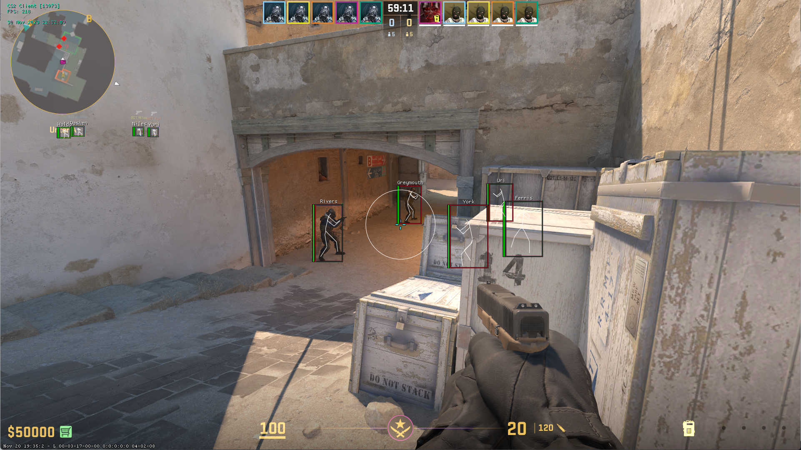

# CS2 Cheat Client

<h3 align="center">

</h3>

## About
This is an internal CS2 client designed specifically for Windows, requiring DirectX11. It was developed utilizing the [cs2-sdk](https://github.com/bruhmoment21/cs2-sdk). The client features a simple GUI and includes various cheats.

## Cheats
The client incorporates the following cheats:

### Aim
- [x] Aimbot

### Visuals
- [x] BoxESP
- [x] WeaponESP
- [x] AntiFlash
- [x] SkeletonESP
- [x] Names
- [x] Healthbar

### Misc
- [x] Bhop (temporary, must be fixed)

## Usage
Utilize ManualMapping for injecting the client and simply press the **INSERT** key to open the Menu. To remove the client, press the **END** key.

## Dependencies
- [kiero](https://github.com/rdbo/ImGui-DirectX-11-Kiero-Hook/tree/master) - directX11 hook
- [minhook](https://github.com/TsudaKageyu/minhook/tree/master) - function hooking
- [imgui](https://github.com/ocornut/imgui) - gui
- [STB](https://github.com/cristeigabriel/STB) - signatures
- [CS2-SDK](https://github.com/bruhmoment21/cs2-sdk) - sdk

